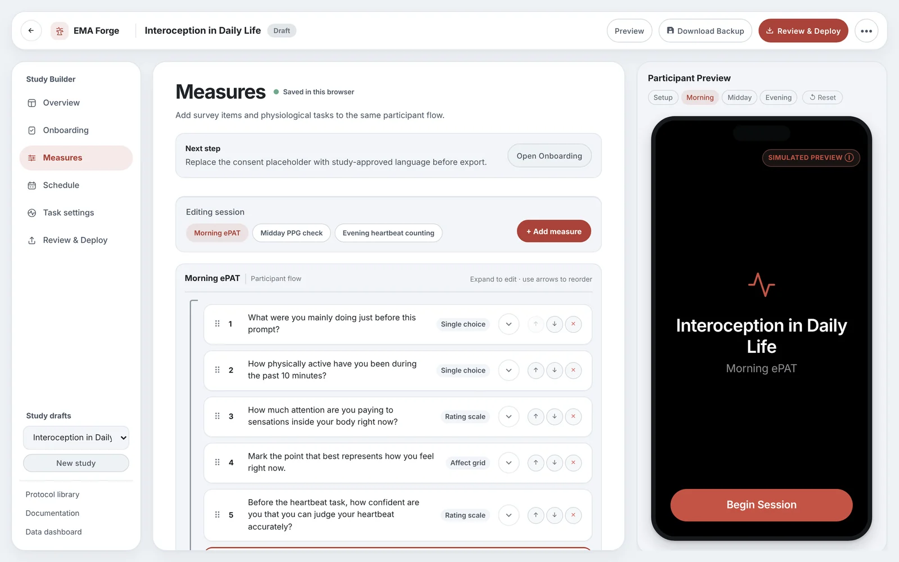
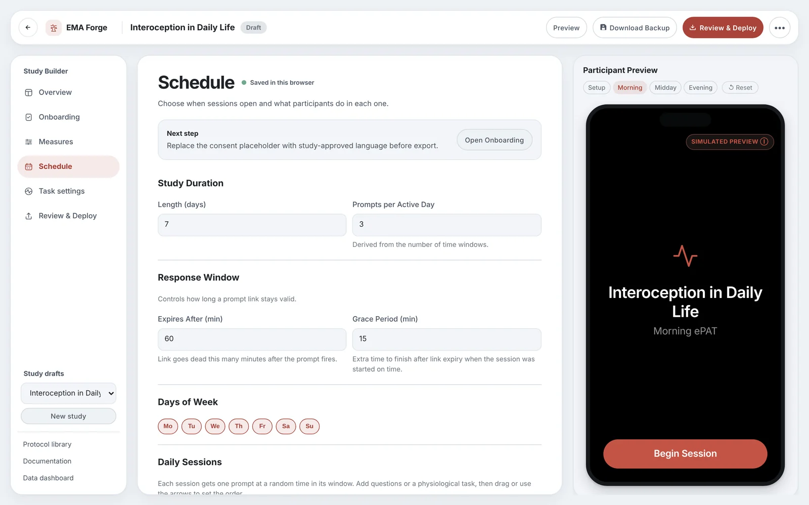
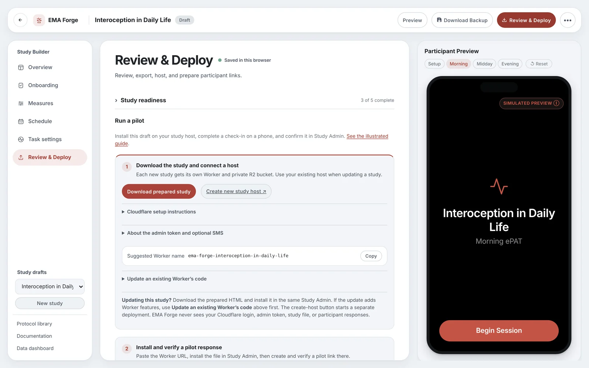
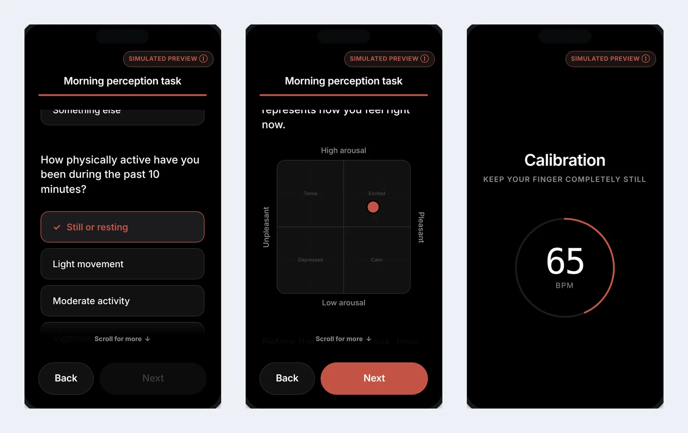
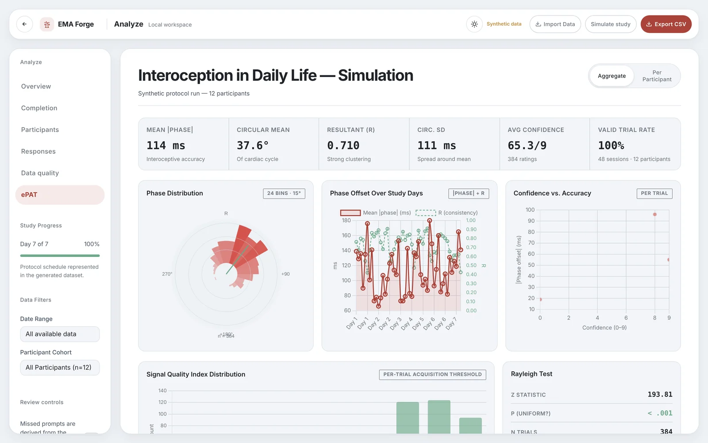
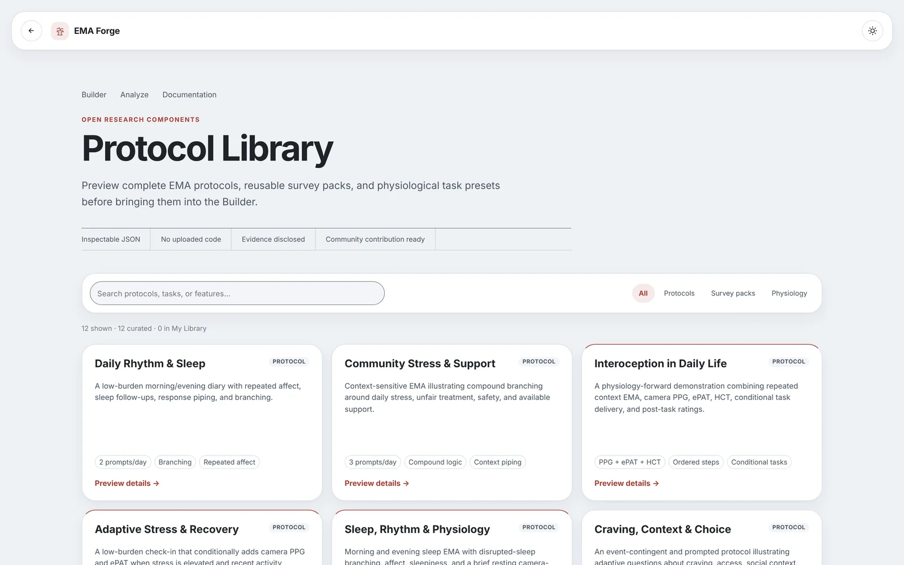
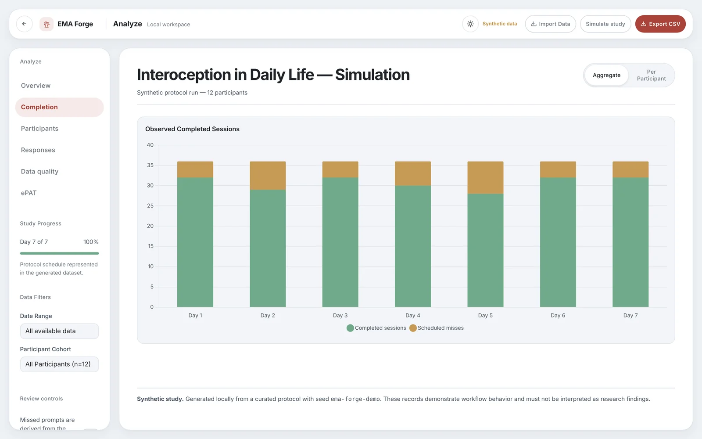

<div align="center">


# EMA Forge

**Build, host, and analyze smartphone EMA studies from your browser, including optional camera-based heart-rate and interoception tasks.**

[](https://github.com/keeganwhitacre/emaforge/releases)
[](LICENSE)
[](cloudflare-deploy/README.md)
[](#development)
[](CITATION.cff)
[](https://github.com/keeganwhitacre/emaforge/commits)

[**Try a sample check-in**](https://emaforge.keeganwhitacre.com/sample.html) ·
[**Open the Builder**](https://emaforge.keeganwhitacre.com/builder.html) ·
[**Protocol Library**](https://emaforge.keeganwhitacre.com/library.html) ·
[**Analyze**](https://emaforge.keeganwhitacre.com/dashboard.html) ·
[**Docs**](https://emaforge.keeganwhitacre.com/readme.html)

</div>

<p align="center">
  
</p>

EMA Forge is a free, open-source toolkit for ecological momentary assessment (EMA) research. You design the study in a browser-based Builder, then deploy it to a Cloudflare Worker and private R2 bucket in **your own** account. Participants tap a link on their phone, and your team manages enrollment, delivery, and responses in a protected Study Admin page. No EMA Forge account is needed, and EMA Forge never sees your Cloudflare login, admin token, study file, or participant responses.

## Contents

- [What it does](#what-it-does)
- [Screenshots](#screenshots)
- [How a study runs](#how-a-study-runs)
- [Measures](#measures)
- [Phone-camera physiology](#phone-camera-physiology)
- [Protocol Library](#protocol-library)
- [Analyze and simulate](#analyze-and-simulate)
- [Reliability in the field](#reliability-in-the-field)
- [Privacy and data flow](#privacy-and-data-flow)
- [Cost and study approval](#cost-and-study-approval)
- [Development](#development)
- [Citation and license](#citation-and-license)

## What it does

| | |
| --- | --- |
| **Builder** | Named drafts saved in the browser, portable backups, onboarding and consent, multi-session schedules, skip logic, response piping, and a live phone preview that updates as you type. |
| **Participant app** | A single HTML file that runs in mobile Safari or Chrome, with no app store install. Handles link expiry, grace periods, double-submission locks, and crash recovery. |
| **Physiology** | Camera photoplethysmography (PPG) heart rate, the ecological Phase Adjustment Task (ePAT), and the heartbeat counting task (HCT), all running in the browser. |
| **Protocol Library** | 6 complete example protocols, validated question packs (K6, PHQ-4, WHO-5), and task presets. Every item is versioned, inspectable JSON. |
| **Hosting & Study Admin** | One Worker plus a private R2 bucket per study. Install and update protocols, verify pilots, manage rosters, create participant invite links, and send scheduled SMS through Twilio (beta). |
| **Analyze** | Browser-local summaries, ePAT circular statistics, protocol-version filtering, long-format CSV export, and protocol-aware synthetic data. |

## Screenshots

<table>
  <tr>
    <td width="50%"></td>
    <td width="50%"></td>
  </tr>
  <tr>
    <td align="center"><b>Schedule</b>: study length, response windows, grace periods, active days</td>
    <td align="center"><b>Review & Deploy</b>: readiness checks and a guided Cloudflare setup</td>
  </tr>
</table>

<p align="center">
  
  <br><sub><b>Participant view</b>: choice items, an affect grid, and camera PPG calibration (shown here in the Builder's simulated preview)</sub>
</p>

<p align="center">
  
  <br><sub><b>Analyze → ePAT</b>: phase distribution, resultant length (R), circular SD, confidence vs. accuracy, signal quality, and a Rayleigh test (synthetic data)</sub>
</p>

<table>
  <tr>
    <td width="50%"></td>
    <td width="50%"></td>
  </tr>
  <tr>
    <td align="center"><b>Protocol Library</b>: browse, preview, and open in the Builder</td>
    <td align="center"><b>Analyze → Completion</b>: completed sessions vs. scheduled misses</td>
  </tr>
</table>

## How a study runs

```text
 Builder (your browser)          Your Cloudflare account                 Participant's phone
 ──────────────────────          ───────────────────────                 ───────────────────
 design + preview      ──HTML──▶ Worker ── serves study ───────────────▶ opens link in browser
 download backup                 │  ◀──────────── POST /submit ──────── completed session
                                 ├─ private R2 bucket (responses)
                                 └─ Study Admin (/admin): roster, invites, SMS, exports
```

1. **Build.** Start from a daily mood check-in, a library protocol, or an empty session. Edit consent, measures, and the schedule, and preview every session in the phone frame.
2. **Host and pilot.** In **Review & Deploy**, download the prepared HTML and create a Cloudflare study host from the template. Install the file in Study Admin and complete a pilot on a real phone. Pilot responses are kept out of research exports.
3. **Enroll and monitor.** Work through the [enrollment checklist](https://emaforge.keeganwhitacre.com/enrollment.html), then create participant links in **Participants & delivery**. Send them yourself or schedule SMS with Twilio (beta), and watch responses arrive in Study Admin.
4. **Update safely.** Re-export from the same draft and install it on the same host. Your study ID, URL, and stored responses are kept, and each configuration change is saved as a new protocol version.

| I want to… | Start here |
| --- | --- |
| Build, host, and test my first study | [Illustrated setup guide](https://emaforge.keeganwhitacre.com/quickstart.html) |
| Move from a pilot to real enrollment | [Enrollment checklist](https://emaforge.keeganwhitacre.com/enrollment.html) |
| Update a running study, set up SMS, or use a different host | [Hosting reference](https://emaforge.keeganwhitacre.com/readme.html#hosting) · [Deployment template](cloudflare-deploy/README.md) |
| Send data to my own storage | [Webhook recipes](https://emaforge.keeganwhitacre.com/readme.html#webhook-recipes) for Google Sheets, REDCap, Azure, AWS, Power Automate, and Cloudflare (beta) |
| Import results or simulate a dataset | [Analyze guide](https://emaforge.keeganwhitacre.com/readme.html#dashboard) |

## Measures

Mix survey items, instruction screens, and tasks in one ordered participant flow. You can add as many survey steps per session as the protocol needs, and use page breaks to split questions across screens.

| Type | Stored as | Notes |
| --- | --- | --- |
| `slider` | number | Min, max, step, unit, and two anchor labels |
| `choice` | string | Single select |
| `checkbox` | array | Multi-select, written as `a;b;c` in CSV |
| `text` / `numeric` | string / number | Numeric input opens the phone's keypad |
| `affect_grid` | `{valence, arousal}` | 2D tap target, both axes on [−1, 1] |
| `body_map` | selected regions | Participants select regions on a body outline |
| `heart_rate` | `{bpm, sqi, ibi_series}` | Camera PPG; the BPM value can drive skip logic |
| `place_context` | `{status, indicators, …}` | Optional area-level location context (see below) |

- **Skip logic** combines AND/OR rules over earlier answers. Skipped items are recorded separately from items that were shown but left unanswered.
- **Response piping** inserts an earlier answer into later question text, with fallback wording for participants who skipped the source question.
- **Conditional tasks** run a task only when a rule is met, for example ePAT only when a stress rating is above a threshold.
- **Place context (optional).** With participant permission, the study Worker looks up five area-level indicators (EPA walkability, Census urban/rural, population density, distance to transit, and share of car-free households) and stores only the categories, never coordinates or block IDs. An on-device GeoJSON mode keeps coordinates on the phone entirely. See [sources and privacy details](https://emaforge.keeganwhitacre.com/readme.html#place-context).

## Phone-camera physiology

All signal processing happens on the participant's phone. Research records hold derived measurements and quality information, and raw video stays on the device.

- **Camera PPG.** The rear camera and torch record the fingertip at about 30 fps. Red and green channels are bandpass filtered (0.67–3.33 Hz, which covers 40–200 BPM) with cascaded Butterworth biquads. A rolling signal-quality index chooses the channel and warns participants when their finger moves.
- **ePAT.** Participants turn a dial until a tone lines up with their felt heartbeat. Each tone's phase offset is measured against PPG-detected beats. The task includes baseline calibration, two-stage practice, per-trial confidence ratings, and configurable trial counts and durations. It is adapted from the Phase Adjustment Task and PAT 2.0 ([prior work](https://emaforge.keeganwhitacre.com/readme.html#acknowledgments)).
- **Heartbeat counting (HCT, beta).** Schandry's (1981) task. Participants count felt heartbeats over timed intervals, and the count is scored against beats detected by the same PPG pipeline. You can choose "count" (Schandry) or "estimate" (Brener/Ring) instructions. To keep participants from being primed by their own heart rate, turn off the BPM display on any heart-rate capture that runs before HCT.
- **IAT (experimental).** An Implicit Association Task that needs no camera, so it runs on any smartphone.

If the camera fails to start, participants can retry or continue without measurement. The record then notes that the task was unavailable, and no physiological value is ever filled in. Camera tasks need device testing and study-specific piloting. See [measurement methods](https://emaforge.keeganwhitacre.com/readme.html#ppg-capture).

## Protocol Library

| Kind | Included |
| --- | --- |
| **Complete protocols** | Daily Rhythm & Sleep · Community Stress & Support · Interoception in Daily Life · Adaptive Stress & Recovery · Sleep, Rhythm & Physiology · Craving, Context & Choice |
| **Question packs** | K6 · PHQ-4 · WHO-5 · Context, Stress & Support |
| **Task presets** | Brief ePAT · Brief Heartbeat Counting |

Each item documents its source, burden, device requirements, and validation status. Question packs remap IDs when added, so branching and piping stay intact. Library JSON cannot run uploaded JavaScript. You can build and download your own items or submit them for human review. See the [catalog and contribution notes](library/README.md).

> A library item is a starting point. Verify licensing, validation evidence, population fit, burden, consent, and safety procedures before you use it.

## Analyze and simulate

In Study Admin, choose **Download analysis file** and open it in [Analyze](https://emaforge.keeganwhitacre.com/dashboard.html). The file bundles every protocol version with its responses, so you can filter to one version at a time. All processing happens in your browser.

- **Views:** overview KPIs, completion, per-participant summaries, item responses, data quality (rapid-session flags, SQI), and ePAT circular statistics.
- **Inputs:** the Study Admin analysis file, raw NDJSON, folders of per-session JSON files plus `config.json`, Google Sheets webhook CSVs, and EMA Forge long-format CSVs.
- **Export:** long-format CSV that keeps answered, unanswered, and condition-skipped states distinct. Twilio dispatch and delivery logs are available as a separate export for missed-prompt analysis.
- **Simulate study:** generates a reproducible, clearly labeled synthetic dataset from a library protocol (you set participants, days, completion rate, missingness, and a random seed). Use it to build your analysis pipeline before data collection starts.

The docs include an [R walkthrough](https://emaforge.keeganwhitacre.com/readme.html#r-analysis) for ingesting JSON files, computing compliance, and splitting affect grid values.

## Reliability in the field

- **Link expiry and grace period.** Links expire a set number of minutes after the prompt time. A participant who started on time gets extra grace time to finish, and sessions cut off by the hard deadline are saved as `expired_in_progress`.
- **Completion lock.** Reopening a finished link shows a "Session Complete" screen, so the same session can't be submitted twice.
- **Crash recovery.** If iOS kills the tab mid-session, reopening the link restores the completed steps and restarts only the step that was interrupted.
- **Delivery retries.** If a session finishes but the upload is interrupted, reopening the same link retries the pending record from that device. Receivers acknowledge an exact retry without overwriting the first stored copy. Participants can also save a local JSON copy.
- **Schema versioning.** The Builder refuses to load drafts from an incompatible schema version, so saved work isn't silently corrupted.

## Privacy and data flow

- Responses go only to the Worker and R2 bucket in **your** Cloudflare account, or to a receiver you configure.
- Study Admin issues opaque invite links. Keep names and contact details out of URLs.
- Camera frames are processed on the phone, and only derived values are stored.
- In-app consent records agreement, initials, and a timestamp. The installed protocol version documents the exact text participants saw.
- SMS phone numbers are kept in the private roster and used only to send messages through Twilio.

The docs include [sample language for study review](https://emaforge.keeganwhitacre.com/readme.html#irb-language) and a list of [known limitations](https://emaforge.keeganwhitacre.com/readme.html#limitations), including incomplete screen-reader support for sliders and the affect grid.

## Cost and study approval

EMA Forge is free. The recommended hosting setup requires GitHub and Cloudflare accounts with R2 billing activated. Check [Workers limits](https://developers.cloudflare.com/workers/platform/limits/), [R2 pricing](https://developers.cloudflare.com/r2/pricing/), and [optional Twilio charges](https://www.twilio.com/en-us/pricing/messaging) when estimating costs.

Before enrollment, review your consent process, hosting and storage, access controls, data retention, and participant device support with your institution. See the [enrollment checklist](https://emaforge.keeganwhitacre.com/enrollment.html) and [privacy reference](https://emaforge.keeganwhitacre.com/readme.html#privacy-model).

## Development

EMA Forge is plain HTML, CSS, and JavaScript with no build step and no runtime dependencies.

```bash
git clone https://github.com/keeganwhitacre/emaforge.git
cd emaforge
python -m http.server 8000      # open http://localhost:8000
npm run check                   # syntax, HTML, and protocol checks + node --test suite
```

Camera tasks require HTTPS on anything other than localhost. The hosted Builder at [emaforge.keeganwhitacre.com](https://emaforge.keeganwhitacre.com/builder.html) always runs the current schema and is the recommended way to build studies.

| Path | Purpose |
| --- | --- |
| `builder.html`, `js/tabs/`, `js/storage.js` | Authoring and local drafts |
| `js/export.js`, `templates/` | Participant runtime and task modules (`epat-core.js`, `module-*.js`) |
| `cloudflare-deploy/` | Study Worker and Study Admin |
| `receiver/` | Standalone upload receiver for independent hosting |
| `dashboard.html`, `js/dashboard/` | Analyze: import, statistics, and simulation |
| `library/` | Versioned protocol catalog |
| `tests/`, `scripts/` | Checks run by `npm run check` |

To add a task module, follow the ePAT reference implementation described in [Under the Hood](https://emaforge.keeganwhitacre.com/readme.html#under-the-hood). Planned work is listed in [potential improvements](https://emaforge.keeganwhitacre.com/readme.html#roadmap). Issues, pull requests, and replication reports are welcome.

## Citation and license

If you use EMA Forge in research, please cite the release you used. Use GitHub's **Cite this repository** menu or [CITATION.cff](CITATION.cff):

> Whitacre, K. (2026). *EMA Forge* (Version 2.0.0) [Computer software]. https://github.com/keeganwhitacre/emaforge

For ePAT, also describe the implementation (PPG pipeline, AudioContext-scheduled stimulus, and dial-alignment response) in your Methods section.

Released under the [MIT License](LICENSE). Created by Keegan Whitacre at the Affective Science Lab, The Ohio State University. Contact: keeganwhitacre at gmail dot com.
